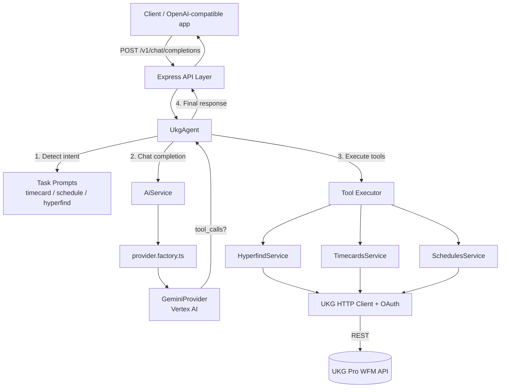

# UKG WFM AI Agent

An AI-powered assistant that answers natural-language questions about **UKG Workforce Management (WFM)** data — timecards, schedules, and co-worker sign-off status — by combining a Large Language Model (Google Gemini) with function-calling tools that query the UKG Pro WFM REST API.

The agent exposes an **OpenAI-compatible** `/v1/chat/completions` endpoint, so it can be used as a drop-in backend for any OpenAI-style chat client.

> **Status:** Phase 1 — Timecards & Schedules are supported today. The architecture is designed to be extended to Accruals, Co-Worker Info, and other UKG WFM functionality (see [Roadmap](#roadmap)).

---

## Table of Contents

- [Features](#features)
- [Architecture](#architecture)
- [Request Flow](#request-flow)
- [Project Structure](#project-structure)
- [Prerequisites](#prerequisites)
- [Getting Started](#getting-started)
- [Configuration](#configuration)
- [API Reference](#api-reference)
- [Example Usage](#example-usage)
- [Extending the Agent](#extending-the-agent)
- [Roadmap](#roadmap)

---

## Features

- **Natural language access to UKG WFM data** — ask about timecards, schedules, and sign-off status in plain English.
- **OpenAI-compatible API** (`/v1/chat/completions`, `/v1/models`) — works with any client built against the OpenAI chat completions contract.
- **Tool/function calling** — the LLM decides when to call UKG data tools (timecards, schedules, hyperfind) and the agent executes them against the live UKG API.
- **Intent-based prompting** — user messages are routed to a task-specific system prompt (timecard, schedule, hyperfind) to keep the model focused and reduce hallucination.
- **Pluggable AI provider layer** — `AiProvider` interface with a `provider.factory.ts` factory, currently implemented for Gemini (via Vertex AI), ready to add OpenAI/Azure/Anthropic/local providers.
- **Structured logging** with Winston, including request IDs for traceability.
- **Zod-validated tool arguments** to guard against malformed function-call parameters from the model.

### Current Agent Capabilities (Phase 1)

| Capability | Description |
|---|---|
| Timecards | Retrieve a co-worker's timecard entries (pay code, hours, days, job, cost center) for a date range. |
| Schedules | Retrieve a co-worker's scheduled shifts and segments (job, cost center, segment type) for a date range. |
| Hyperfind — Unsigned Co-workers | Retrieve the list/count of co-workers who have **not** signed off their timecards for a date range. |

---

## Architecture



### Layers

- **API layer** (`src/api`) — Express routes exposing an OpenAI-compatible surface (`/health`, `/v1/chat/completions`, `/v1/models`).
- **Agent layer** (`src/agents`) — `UkgAgent` orchestrates intent detection, prompt selection, AI calls, and tool execution.
- **AI module** (`src/modules/ai`) — Provider-agnostic chat completion service with a factory that selects the configured `AiProvider` (currently Gemini/Vertex AI).
- **UKG module** (`src/modules/ukg`) — OAuth client-credentials auth, a shared HTTP client, and feature-specific services/mappers/types for Hyperfind, Timecards, and Schedules.

---

## Request Flow

1. Client sends a chat message to `POST /v1/chat/completions`.
2. `UkgAgent` inspects the latest user message to detect intent (timecard, schedule, sign-off/hyperfind) using keyword/regex matching.
3. The matching task prompt is combined with the system prompt and the conversation, then sent to the configured AI provider along with the available tool definitions.
4. If the model responds with one or more `tool_calls`, the agent executes them via the **Tool Executor**, which validates arguments with Zod and calls the matching UKG service (Hyperfind / Timecards / Schedules).
5. Tool results are appended to the conversation and a second AI call produces the final natural-language answer.
6. The agent returns an OpenAI-compatible `ChatCompletionResponse` to the client.

---

## Project Structure

```
src/
├── app.ts                     # Express app: middleware, routing, error handling
├── server.ts                  # HTTP server bootstrap, graceful shutdown
├── agents/
│   ├── ukg.agent.ts           # Core orchestration: intent detection → AI → tools → AI
│   ├── prompts/                # System + task-specific prompts
│   │   ├── system.prompt.ts
│   │   ├── timecard.prompt.ts
│   │   ├── schedule.prompt.ts
│   │   ├── hyperfind.prompt.ts
│   │   └── people.prompt.ts    # Reserved for future Co-Worker Info feature
│   └── tools/                  # Function-calling tool definitions + executor
│       ├── get-timecards.tools.ts
│       ├── get-schedules.tools.ts
│       ├── get-hyperfind.tools.ts
│       ├── tool-registry.ts
│       └── tool-executor.ts
├── api/
│   ├── routes.ts               # Mounts /health, /v1/chat/completions, /v1/models
│   ├── chat.routes.ts
│   ├── health.routes.ts
│   └── models.routes.ts
├── config/
│   ├── env.ts                  # Loads process.env via dotenv
│   ├── ai.config.ts            # AI provider + model configuration
│   ├── clound.config.ts        # GCP / Vertex AI configuration
│   ├── ukg.config.ts           # UKG OAuth + API base URL configuration
│   └── logger.config.ts        # Winston logger configuration
├── common/
│   └── logger.ts
└── modules/
    ├── ai/
    │   ├── ai.service.ts
    │   ├── ai.module.ts
    │   ├── chat/chat-completion.types.ts   # OpenAI-compatible request/response types
    │   └── providers/
    │       ├── ai-provider.interface.ts
    │       ├── provider.factory.ts
    │       ├── gemini.provider.ts
    │       └── local.provider.ts
    └── ukg/
        ├── ukg.auth.ts          # OAuth client-credentials token retrieval
        ├── ukg.client.ts        # Authenticated fetch wrapper for the UKG API
        ├── hyperfind/
        ├── timecards/
        └── schedules/
```

---

## Prerequisites

- **Node.js** 18+ and **Yarn** (or npm)
- A **UKG Pro WFM** tenant with API credentials (OAuth client credentials grant)
- A **Google Cloud project** with Vertex AI enabled (for the Gemini provider)

---

## Getting Started

```bash
# Install dependencies
yarn install

# Copy the environment template and fill in your values
cp .env.example .env

# Run in watch mode (ts-node-dev)
yarn dev

# Or build and run the compiled output
yarn build
yarn start
```

By default the server listens on `http://localhost:5858` (configurable via `PORT`/`HOST`). On startup it logs the health check and chat completion endpoint URLs.

---

## Configuration

All configuration is loaded from environment variables via [src/config/env.ts](src/config/env.ts) (using `dotenv`). Copy [.env.example](.env.example) to `.env` and set the values below.

### Server

| Variable | Description | Default |
|---|---|---|
| `NODE_ENV` | `development` or `production`; affects logging format/verbosity | `development` |
| `PORT` | HTTP port the server listens on | `5858` |
| `HOST` | Host/interface to bind to | `0.0.0.0` |

### AI Provider

| Variable | Description | Default |
|---|---|---|
| `AI_PROVIDER` | Active provider resolved by `provider.factory.ts`. Only `gemini` is implemented today. | — |
| `GEMINI_MODEL` | Gemini model name used for chat completions | `gemini-2.5-flash-lite` |
| `GCP_PROJECT` / `GOOGLE_CLOUD_PROJECT` | GCP project used for Vertex AI | — |
| `VERTEX_LOCATION` | Vertex AI region | `global` |

### UKG WFM

| Variable | Description |
|---|---|
| `UKG_CLIENT_ID` | OAuth client ID issued by UKG |
| `UKG_CLIENT_SECRET` | OAuth client secret |
| `UKG_AUDIENCE` | OAuth audience for the token request |
| `UKG_GRANT_TYPE` | OAuth grant type (client credentials flow) |
| `UKG_ORGANIZATION` | UKG tenant/organization identifier |
| `UKG_AUTH_URL` | UKG OAuth token endpoint |
| `UKG_API_BASE_URL` | Base URL for UKG Pro WFM REST API calls |

> **Note:** Authentication uses the OAuth 2.0 client-credentials grant (see `src/modules/ukg/ukg.auth.ts`). Never commit real credentials — keep them only in your local `.env` file, which is git-ignored.

---

## API Reference

### `GET /health`
Liveness check.

```json
{ "status": "ok", "service": "ukg-wfm-ai-agent", "timestamp": "2026-10-07T00:00:00.000Z" }
```

### `GET /v1/models`
Lists the model(s) exposed by the agent (OpenAI-compatible `models.list` shape).

### `POST /v1/chat/completions`
OpenAI-compatible chat completions endpoint. Streaming (`stream: true`) is **not** currently supported and is rejected with a `400` error.

**Request body:**

```json
{
  "model": "UKG-WFM-AI-AGENT",
  "messages": [
    { "role": "user", "content": "Can you please check the coworker schedule for july 14th to 21st of 2026" }
  ]
}
```

**Response body:** a standard `ChatCompletionResponse` (`id`, `object`, `created`, `model`, `choices[]`, `usage`).

---

## Example Usage

```bash
curl -X POST http://localhost:5858/v1/chat/completions \
  -H "Content-Type: application/json" \
  -d '{
    "model": "UKG-WFM-AI-AGENT",
    "messages": [
      { "role": "user", "content": "Which co-workers have not signed off their timecards between 2026-09-01 and 2026-09-07?" }
    ]
  }'
```

Other example questions the agent understands today:

- "Show me employee 123456's timecard for last week."
- "Can you please check the coworker schedule for july 14th to 21st of 2026"
- "Get the list of co-workers who are not signed off this pay period."

---

## Extending the Agent

The codebase is intentionally modular so new UKG capabilities can be added without touching the core orchestration logic:

1. **Add a UKG service** under `src/modules/ukg/<feature>/` with `*.types.ts`, `*.model.ts`, `*.mapper.ts`, and `*.service.ts`, following the pattern used by `timecards`/`schedules`/`hyperfind`.
2. **Define a tool** in `src/agents/tools/get-<feature>.tools.ts` describing the function schema (name, description, parameters) and its handler, then register it in `tool-registry.ts` and `tool-executor.ts`.
3. **Add a task prompt** in `src/agents/prompts/<feature>.prompt.ts` describing when/how the model should call the new tool, and wire up intent detection in `ukg.agent.ts`.
4. **Add an AI provider** by implementing `AiProvider` (`src/modules/ai/providers/ai-provider.interface.ts`) and registering it in `provider.factory.ts` to support OpenAI, Azure OpenAI, Anthropic, or local models alongside Gemini.

---

## Roadmap

- [ ] **Co-Worker Info** lookup (`people.prompt.ts` is reserved for this)
- [ ] **Accruals** (PTO/leave balances)
- [ ] Additional Hyperfind queries beyond "non-signed-off co-workers"
- [ ] Streaming chat completions
- [ ] Additional AI providers (OpenAI, Azure OpenAI, Anthropic, local/on-prem models)
- [ ] OAuth token caching/refresh for the UKG client
